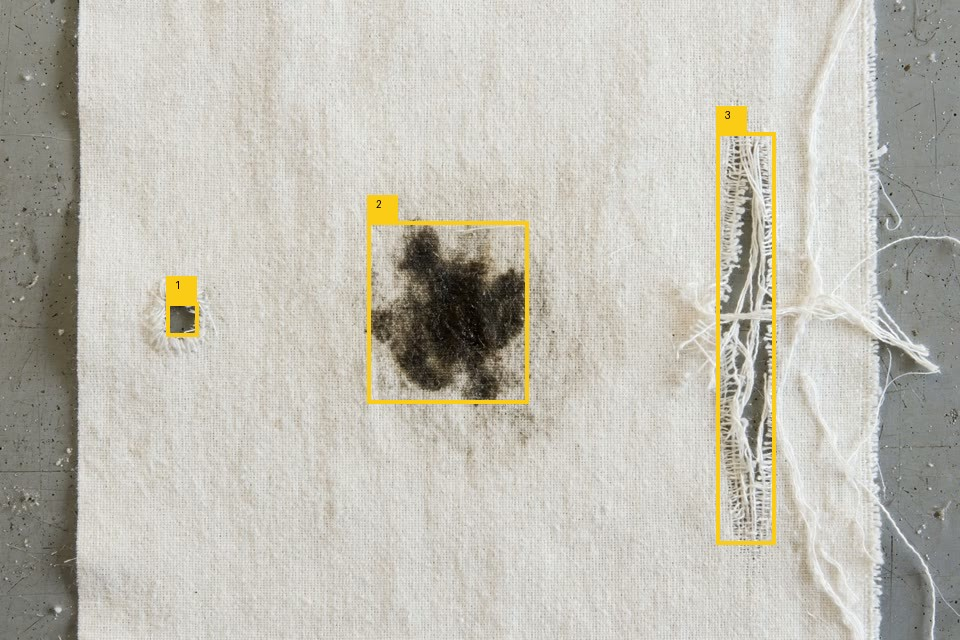

# Sumora × Meta Muse

**Sumora gives a small business a working team of AI agents from one conversation.** The team runs the website, bookings, WhatsApp and payments, and it asks the owner before anything risky. Every agent thinks with **Meta Muse Spark**.

Submitted to the **Meta Global AI Developer Hackathon 2026**: Startups Track, "Build for Your World".

- **Live product (staging):** https://staging-app.trysumora.com (judge login in the submission form)
- **Company:** https://trysumora.com

<p align="center"><br><sub>A website hero painted by <b>Muse Image</b> for a home bakery in Pune, made during Sumora's build step.</sub></p>

## Agents with eyes: SAM 3.1 finds, Muse Wonder judges

<p align="center"></p>

Our judge demo business, **Drishti Vision** (a sample AI startup in Surat), sells fabric inspection to small textile mills. Sumora runs its front office. When a mill owner sends a photo of a roll on WhatsApp, the front-desk agent calls one tool, and two Meta models split the work:

1. **SAM 3.1** proposes every candidate region for open-vocabulary prompts ("hole", "stain", "tear", "fabric defect"). It localises precisely, but its labels overlap: "hole" also catches the stain. We merge overlapping boxes by IoU.
2. **Muse Wonder** sees the photo with the numbered boxes and classifies each one (hole, stain, tear, slub, not a defect) with a severity, a verdict and a reply for the mill owner.

A live run (22 s, real API):

```
SAM 3.1 candidate regions: 3 · verdict: REJECT
  1. hole   major    box=166,302–198,336
  2. stain  major    box=367,221–528,403
  3. tear   major    box=716,132–775,544
Reply to the mill owner:
All three are real problems: 1 is a small hole with frayed edges, 2 is a large dark stain blotch, and 3 is a long
vertical tear with broken threads. Please do not ship this as first quality; pull the roll, cut out or downgrade the
damaged section, and check the loom/handling for what caused the holes, tearing, and staining.
```

The test photo was itself generated by **Muse Image**, so one Meta model created the test data that two others inspected (`examples/fabric.jpg`). Run it with `python examples/inspect_demo.py`. The code is in `sumora_muse/inspect.py`.

## Why this exists

In India and the US, tens of millions of one-to-five-person businesses run on WhatsApp, a notebook and the owner's evenings: home bakers, tutors, clinics, salons, advocates. They don't need another dashboard; they need staff. Sumora hires that staff for them: a front desk that answers at 11 pm, books the slot, takes the payment, and reports in the morning. It never refunds, spends or publishes without the owner's OK.

## What's in this repo

This is the open part of Sumora: **the Meta Model API layer** that every Sumora agent runs on. The full platform (onboarding, Temporal workflows, channels, billing, data model, prompts) is a private monorepo. The code here is the same design, extracted and tested on its own.

| Module | Meta product | What it does in Sumora |
|---|---|---|
| `sumora_muse/client.py` | Meta Model API | Chat, image and voice client. It handles Muse Spark's reasoning budget: if hidden reasoning uses up `max_tokens`, it grows the budget instead of returning an empty answer. It also retries with backoff on 429/5xx. |
| `sumora_muse/catalog.py` | **Muse Wonder 1.0** (vision + structured output) | The owner photographs the menu or price list. One call turns it into typed catalogue facts: items, prices, "from ₹X" prices, hours, closed days, area, payment, lead time. |
| `sumora_muse/router.py` | **Muse Wonder 1.0 + Muse Spark 1.3** | Per-role model chains. Planning and vision go to Muse Wonder; high-volume turns (interview, command, agent, brief) go to Muse Spark 1.3. Fallback happens only on server or rate-limit errors. Every call is recorded (model, latency, tokens, reasoning tokens) so the product can show which model made each decision. |
| `sumora_muse/team.py` | Muse Spark **structured output** | Turns one sentence about a business into a typed agent team: jobs, channels, tools, and the actions that need owner approval. |
| `sumora_muse/agent.py` | Muse Spark **tool calling** | The agent loop. Safe tools run. Risky tools (refunds, payments, new contacts, publishing) become owner approval requests, and the agent tells the customer honestly that the owner will confirm. |
| `sumora_muse/inspect.py` + `client.segment` | **SAM 3.1** + **Muse Wonder** | Agents with eyes: SAM 3.1 localises defects or objects in a customer's photo; Muse Wonder classifies them and writes the verdict. |
| `client.generate_image` | **Muse Image 1.0** | Paints the hero and cover images for each business's website. |
| `client.transcribe` | **Muse Voice Transcribe 1.0** | Owner WhatsApp voice notes become commands for the agents. |

In production, these agents reach customers and owners through the **WhatsApp Business Platform** (Sumora's sender: verification codes, daily briefs, approve or decline from chat).

## Run it (2 minutes)

```bash
pip install -e ".[dev]"
pytest -q                                   # 11 offline tests, no key needed
export MODEL_API_KEY=...                    # from dev.meta.ai
python examples/demo.py --voice owner-note.wav     # uses examples/menu.jpg
```

Real output from the live API (2026-11-04):

```
0) Muse Wonder reads the owner's menu photo
   · vision   muse-wonder-1.0    5900 ms  ok=True
   Asha's Home Bakery: 4 items · ₹240–₹1,800 · Pickup 11am-8pm, closed Mondays
   - Cardamom buns (box of 6): ₹240 / box of 6
   - Chocolate truffle cake: ₹1100 / 1 kg
   - Eggless vanilla cake: ₹520 / 500 g
   - Custom theme cake: from ₹1800 / per kg

1) Muse Wonder designs the team
   · planner  muse-wonder-1.0   13718 ms  ok=True
   - WhatsApp Order Assistant: … Never accept a pickup on Monday (closed) … (approval: confirming any custom cake order,
     issuing a refund or discount, first message to a new contact, changing prices or public posts, any payment)
   - Baking & Pickup Planner: turn confirmed orders into a daily bake and pickup list, track stock …
     (approval: spending money on ingredients or packaging, refunds, new contacts, publishing)

2) Front Desk agent handles a customer (Muse Spark tool calling)
   tool check_slots({"day": "2026-11-06"}) -> {"free": ["2026-11-06 16:00", "2026-11-06 18:00"]}
   tool refund({"amount_inr": 450, "order_id": "A17"}) -> {"status": "pending_owner_approval", …}
   ⏸  held for owner approval: refund {"amount_inr": 450, "order_id": "A17"}
   reply: Hi Priya! … for 6 Nov evening we have 4pm and 6pm free … refund of ₹450 — noted! The owner will confirm shortly.

3) Muse Image paints the website hero
   saved out/hero.webp (459 KB)

4) Muse Voice Transcribe: owner voice note -> command
   heard: move tomorrow's 4 PM cake pickup for Priya to 6 PM and tell her on WhatsApp.
   tool move_booking({"customer": "Priya", "from_slot": "2026-11-06 16:00", "to_slot": "2026-11-06 18:00"}) -> {"ok": true, …}
   tool send_whatsapp({"customer": "Priya", "text": "Hi Priya, your 1 kg chocolate cake pickup tomorrow (2026-11-06) has been moved from 4 PM to 6 PM. See you at 6 PM!"}) -> {"ok": true, …}
   reply: Moved Priya's pickup to 2026-11-06 18:00 and sent WhatsApp confirmation.

Model calls: 6 · tokens: 9046 · every call ran on Meta Muse.
```

## Architecture

```
owner ── web (/start onboarding, Command) ─┐
      └─ WhatsApp (Cloud API: text + voice) ┤
customer ── WhatsApp / website chat ────────┤
                                            ▼
                         FastAPI exec + MCP tool server
                                            │  durable runs, schedules, retries,
                                            ▼  approvals as workflow signals
                                    Temporal workers
                                            │
                     ┌──────────────────────┼──────────────────────┐
                     ▼                      ▼                      ▼
             Router (this repo)     Approval gate (this repo)   Media (this repo)
             Muse Spark per role    risky tools → owner         Muse Image, Muse Voice
                     │
                     ▼
        Meta Model API  ·  Postgres (tenant-isolated workspaces)  ·  audit log of every model decision
```

Details are in [`docs/architecture.md`](docs/architecture.md).

## Lessons from building on Muse Spark and Muse Wonder

- **Use the right Muse for each job.** On the same menu photo, Muse Wonder returned clean JSON in about 4–9 s and Muse Spark 1.3 in about 10 s. Wonder plans and reads; Spark talks.
- **Field names are part of the prompt.** With a strict schema field called `hours`, Wonder missed "Pickup 11am–8pm" in 3 of 5 runs. Renaming the field to `opening_or_pickup_hours` fixed it: 3 of 3.

- **Reasoning tokens count against `max_tokens`.** With a 20-token budget, Muse Spark 1.3 returned `content: null` and `finish_reason: "length"`, having spent all 20 tokens thinking. The client now grows the budget automatically, and agent turns use `reasoning_effort: "low"`.
- **Strict JSON-schema output was reliable for team design.** It is the backbone of onboarding.
- **Tool calling chains sensibly.** In one turn it called `move_booking` and then `send_whatsapp`, and it refused to invent availability when no slot was free.

## License

MIT for the code in this repository.
